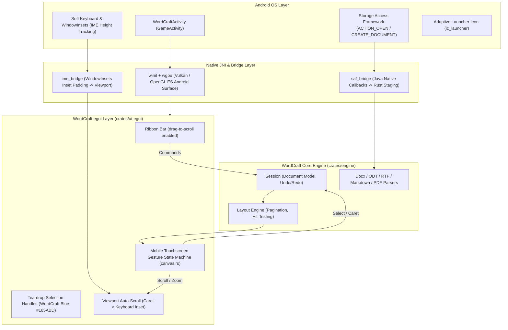

<p align="center">
  
</p>

<h1 align="center">WordCraft for Android</h1>

<p align="center">
  <b>The official touch-optimized native Android port of the pure-Rust WordCraft word processor.</b><br>
  <i>100% authentic upstream white-and-blue WordCraft UI with a dedicated Mobile Touchscreen Gesture State Machine.</i>
</p>

<p align="center">
  <a href="https://github.com/tiborequiem/Wordcraft-Android/releases/latest">
    
  </a>
</p>

<p align="center">
  
  
  
  
  
  
</p>

---

## 📱 Overview

**WordCraft Android** brings WordCraft's full desktop word-processing power to Android devices. Unlike standard mobile ports that degrade the interface or suffer from touchscreen input bugs, WordCraft Android delivers:

1. **Authentic Upstream Visual Identity**: Preserves 100% of the original `storytold/wordcraft` white-and-blue `egui` interface—including the full Ribbon toolbar, Styles gallery, dialogs, status bar, and page canvas.
2. **Dedicated Mobile Touchscreen Gesture State Machine**: Completely eliminates accidental text selection during scrolling. A single finger swipe smoothly pans the document with natural kinetic momentum fling, while text selection is cleanly managed via taps, double-taps, long-presses, and draggable teardrop handles.
3. **Android Storage Access Framework (SAF)**: Full integration with native Android file pickers (`ACTION_OPEN_DOCUMENT` and `ACTION_CREATE_DOCUMENT`), staging byte streams for `.docx`, `.odt`, `.rtf`, `.md`, and `.txt` documents.
4. **Soft Keyboard (IME) with Viewport Auto-Scroll**: Tapping places the caret and summons the keyboard, with the viewport automatically scrolling to keep your active typing line comfortably above the soft keyboard.
5. **Adaptive Launcher Icon**: Custom WordCraft adaptive icon (`ic_launcher` / `ic_launcher_round`) with crisp vector assets for modern Android home screens.

---

## 👆 Touchscreen Gestures

| Gesture | Action |
|---|---|
| **1-Finger Drag / Swipe** | **Scrolls Document Viewport** vertically & horizontally with exponential kinetic fling momentum. *Never accidentally selects text.* |
| **Ribbon Swipe** | Touch-drag scrolling across the top Ribbon toolbar and Table Styles gallery for narrow mobile screens. |
| **Single Tap (< 8dp)** | Places text caret at the tapped location and opens the soft keyboard (IME). |
| **Double-Tap / Long-Press (400ms)** | Selects the word under the finger and reveals draggable **WordCraft Blue Teardrop Selection Handles**. |
| **Dragging Selection Handles** | Expands or contracts the selection range precisely without scrolling interference. |
| **Two-Finger Pinch** | Smoothly zooms the page canvas in/out around the pinch focal point. |

---

## 🏗️ Architecture



---

## 📥 Download Pre-built APK

You can download the latest pre-built APK directly from GitHub Releases:

👉 **[Download Latest APK from Releases](https://github.com/tiborequiem/Wordcraft-Android/releases/latest)**

---

## 🛠️ Building from Source

### Prerequisites
- Android SDK (API 28+) & NDK (26+)
- JDK 17 (recommended: Eclipse Temurin JDK 17)
- Rust toolchain with target:
  ```bash
  rustup target add aarch64-linux-android
  cargo install cargo-ndk
  ```

### One-Command Build Script
A turnkey automated build script is provided at the repository root:

```bash
# Set your SDK/NDK paths if not standard
export ANDROID_HOME=$HOME/Android/Sdk
export ANDROID_NDK_HOME=$(ls -d $HOME/Android/Sdk/ndk/* | tail -n 1)

# Build the arm64-v8a native shared library and assemble debug APK
./build_apk.sh
```

The resulting APK will be placed at `./wordcraft-android-v0.10.0-debug.apk` and inside `apps/wordcraft-android/android/app/build/outputs/apk/debug/`.

---

## 📄 License & Attribution

- WordCraft Android is licensed under **MIT OR Apache-2.0**.
- Built on top of the clean-room, open-source [`storytold/wordcraft`](https://github.com/storytold/wordcraft) engine.
- No proprietary Microsoft, Adobe, Avid, or Autodesk assets or iconography are used. All icons and UI elements are original or open-source.
